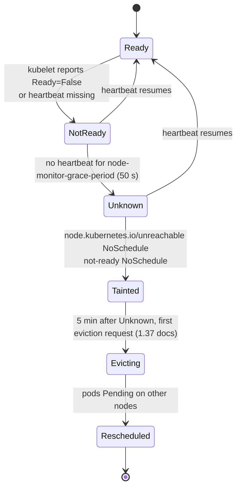

# VKS Availability Metrics and Events

Availability is whether an object is able to serve work. Unlike the contention and consumption metrics, availability is mostly driven by **events and state changes**: a node stops heartbeating, a pod crashes, a rollout stalls. The metrics are the counts and ratios that these changes produce. The events are the records of the transitions.

Grouped by object type, in the same order as [README.md](README.md). Formulas are in [metrics-formulas.md](metrics-formulas.md). Source codes are as in [metrics.md](metrics.md), plus `PROM`, `VCFO` and `EVT`.

## How a node failure becomes a pod failure

Most availability problems start with a node. This is the chain in upstream Kubernetes, from the node controller's timers (values from secondary sources, see [research-notes.md](research-notes.md)):

Each step writes an event or a condition, so the chain can be seen in both places:

| Step | Object changed | Event reason (`EVT`) | Metric that moves |
|---|---|---|---|
| Ready turns False or Unknown | `Node` `conditions[type=Ready]` | `NodeNotReady` | `kube_node_status_condition{condition="Ready"}` (PROM) |
| Taint applied | `Node` `spec.taints` | Node controller event (not verified) | `KubeNodeUnreachable` (PROM, `for` 15 min) |
| Pods failed | `Pod` `status.phase` set to `Failed` for Pods on the lost node | Pod phase change (1.37 docs). The Pod's own events depend on the path | pods not ready; `KubePodNotReady` (`for` 15 min) |
| Replacement pods | `Pod` phase `Pending` | `FailedScheduling` if no room | `KubeDeploymentReplicasMismatch` |

## Supervisor (object type 1)

| Metric / state | Unit | Source | Field | Condition for "unavailable" | Notes |
|---|---|---|---|---|---|
| Config status | enum | VC | `info.config_status` | `ERROR` or `REMOVING` | Property. Metric form: 1 when not `RUNNING` |
| Kubernetes status | enum | VC | `info.kubernetes_status` | `ERROR`, `WARNING` | |
| Supervisor services in error | count | Derived | `config_status` = `ERROR` | count > 0 | Services that do not reconcile are unavailable |
| Upgrade state | enum | VC | `software/clusters` `state` | not steady | Upgrades change availability |

## Supervisor Namespace (object type 2)

| Metric / state | Unit | Source | Field | Condition | Notes |
|---|---|---|---|---|---|
| Config status | enum | VC | `config_status` | `ERROR` | |
| Network ready | bool | SUP | `conditions[type=NamespaceNetworkReady]` | `False` | Workloads cannot get addresses |
| Phase | enum | SUP | `status.phase` | `Terminating` for long | |

## K8s Cluster (object type 4)

| Metric / state | Unit | Source | Field | Condition | Notes |
|---|---|---|---|---|---|
| Control plane availability | ratio | Derived | `status.controlPlane.availableReplicas ÷ desiredReplicas` | < 1 | Quorum needs the majority of control-plane nodes |
| Worker availability | ratio | Derived | `status.workers.availableReplicas ÷ desiredReplicas` | < 1 | |
| Available | bool | SUP | `conditions[type=Available]` | `False` | Cluster API v1beta2 name |
| Control plane available | bool | SUP | `conditions[type=ControlPlaneAvailable]` | `False` | |
| Workers available | bool | SUP | `conditions[type=WorkersAvailable]` | `False` | |
| Remote connection probe | bool | SUP | `conditions[type=RemoteConnectionProbe]` | `False` | Supervisor cannot reach the cluster API |
| API server up | bool | VCFO | "API Server Up Status" | `False` | |
| Nodes down | count | VCFO | "Node(s) Down" | > 0 | |
| Kubelets down | count | VCFO | "Kubelet(s) Down" | > 0 | |
| Kubelet down | bool | PROM | `up` (kubelet) | 0 for 15 min | `KubeletDown`, critical |
| API server 5xx | ratio | PROM | `apiserver_request_total{code=~"5.."}` | > 1 % over 5 min | `KubeClientErrors`, warning |
| Component health | bool | SUP | Machine conditions `APIServerPodHealthy`, `EtcdMemberHealthy` … | `False` | Control-plane components |
| Remediating | bool | SUP | `conditions[type=Remediating]` | `True` | Cluster API remediation in progress |

## K8s Node Pool (object type 5)

| Metric / state | Unit | Source | Field | Condition | Notes |
|---|---|---|---|---|---|
| Nodes ready ratio | ratio | SUP | `status.readyReplicas ÷ spec.replicas` | < 1 | |
| Nodes available ratio | ratio | SUP | `status.availableReplicas ÷ spec.replicas` | < 1 | |
| Machines ready | bool | SUP | `conditions[type=MachinesReady]` | `False` | |
| Phase | enum | SUP | `status.phase` | `Failed` | |
| Remediating | bool | SUP | `conditions[type=Remediating]` | `True` | |

## K8s Node (object type 6)

| Metric / state | Unit | Source | Field | Condition | Notes |
|---|---|---|---|---|---|
| Ready | bool | K8S | `conditions[type=Ready]` | `False` or `Unknown` | Base availability signal |
| Node availability | % | Derived | minutes Ready ÷ minutes in window | < 100 | Computed from Ready transitions over time |
| Not ready for 15 min | flag | PROM | `kube_node_status_condition{condition="Ready",status="true"} == 0` | 15 min | `KubeNodeNotReady`, warning |
| Readiness flapping | count | PROM | changes of Ready in 15 min | > 2 | `KubeNodeReadinessFlapping`, warning |
| Unreachable taint | flag | K8S | taint `node.kubernetes.io/unreachable` | present | Node controller set it (verify the taint key in the cluster) |
| Machine phase | enum | SUP | `Machine` `status.phase` | `Failed`, `Deleting` | VKS |
| Machine health | bool | SUP | `Machine` `conditions[type=NodeHealthy]`, `HealthCheckSucceeded` | `False` | VKS |
| Certificate expiry | date | SUP | `Machine` `status.certificatesExpiryDate` | soon | Control-plane nodes. `KubeletClientCertificateExpiration` at 7 days (warning), 1 day (critical) |
| VM power state | enum | SUP | `VirtualMachine` `status.powerState` | `PoweredOff`, `Suspended` | Hypervisor-level availability |
| Disk / memory / PID pressure | bool | K8S | `conditions[type=DiskPressure]` etc. | `True` | Pods are evicted, so pressure is an availability risk. `KubeNodePressure`, info, 10 min |
| Kubelet evictions | count / s | PROM | `kubelet_evictions` | > 0 | `KubeNodeEviction`, `for` 0 s |
| PLEG relist time | seconds | PROM | `kubelet_pleg_relist_duration_seconds` | p99 >= 10 s | `KubeletPlegDurationHigh`. Kubelet is slow to see containers |
| Node-level OOM | — | — | not a kubelet event | — | Kubelet 1.35.9 emits no OOM event. Container OOM shows as `OOMKilled` in container status (see contention) |
| Node events | event | EVT | `NodeNotReady`, `NodeReady`, `EvictionThresholdMet` | any | Confirmed in kubelet 1.35.9 source. Pressure-condition events were not found |

## K8s Namespace (object type 7)

| Metric / state | Unit | Source | Field | Condition | Notes |
|---|---|---|---|---|---|
| Phase | enum | K8S | `status.phase` | `Terminating` | Stuck deletes block new objects |
| Quota exceeded | ratio | K8S | `status.used ÷ status.hard` | > 1 | `KubeQuotaExceeded`, warning. *(schema)* |
| Quota fully used | ratio | K8S | `status.used ÷ status.hard` | = 1 | `KubeQuotaFullyUsed`, info |

## K8s Workload (object type 8)

| Metric / state | Unit | Source | Field | Condition | Notes |
|---|---|---|---|---|---|
| Availability ratio | ratio | K8S | `status.availableReplicas ÷ spec.replicas` | < 1 | |
| Deployment replicas mismatch | count | PROM | `kube_deployment_spec_replicas > …_available` (no update in 10 min) | 15 min | `KubeDeploymentReplicasMismatch`, warning |
| StatefulSet replicas mismatch | count | PROM | `kube_statefulset_status_replicas_ready != kube_statefulset_replicas` | 15 min | `KubeStatefulSetReplicasMismatch` |
| DaemonSet rollout stuck | count | PROM | scheduled / available / misscheduled vs desired | 15 min | `KubeDaemonSetRolloutStuck` |
| Deployment Available condition | bool | K8S | `conditions[type=Available]` | `False` | |
| Deployment Progressing condition | bool | K8S | `conditions[type=Progressing]` | `False` | Rollout stalled (for example `ProgressDeadlineExceeded`) |
| Job failed | count | PROM | `kube_job_failed > 0` | 15 min | `KubeJobFailed`, warning |
| Job Complete / Failed condition | bool | K8S | `conditions[type=Complete]`, `Failed` | `Failed` = `True` | |
| CronJob last success | time | K8S | `status.lastSuccessfulTime` | old | Missed schedules. Not in the lab |
| Events | event | EVT | `FailedCreate`, `ProgressDeadlineExceeded` (not verified) | any | Controller-side |

## K8s Pod (object type 9)

| Metric / state | Unit | Source | Field | Condition | Notes |
|---|---|---|---|---|---|
| Ready | bool | K8S | `conditions[type=Ready]` | `False` | Base availability signal |
| Phase | enum | K8S | `status.phase` | `Failed`, `Unknown`, `Pending` (long) | `KubePodNotReady`: `Pending` or `Unknown` or `Running` but not ready, for 15 min |
| Containers ready | bool | K8S | `conditions[type=ContainersReady]` | `False` | |
| Pod scheduled | bool | K8S | `conditions[type=PodScheduled]` | `False` | Reason `Unschedulable` |
| Pod failure reason | string | K8S | `status.reason` | `Evicted` | `status.message` gives the detail (*(schema)*) |
| Crash loop | flag | PROM | `kube_pod_container_status_waiting_reason{reason="CrashLoopBackOff"}` | ≥ 1 for 5 min | `KubePodCrashLooping`, warning |
| Waiting too long | flag | PROM | `kube_pod_container_status_waiting_reason != CrashLoopBackOff` | > 0 for 1 h | `KubeContainerWaiting` |
| Restarts | count | Derived | Σ `restartCount` | rate > 0 | Restart rate: see formulas |
| Pod restarts (VCF Operations) | count | VCFO | "Total Restarts" (computed) | rate | |
| Pod status | enum | VCFO | "Status" | not `Running` | |
| Events | event | EVT | `BackOff`, `Unhealthy`, `Evicted`, `FailedMount`, `Killing` | any | All confirmed in kubelet 1.35.9 source; `FailedScheduling` comes from the scheduler |

## K8s Container (object type 10)

| Metric / state | Unit | Source | Field | Condition | Notes |
|---|---|---|---|---|---|
| Ready | bool | K8S | `status.containerStatuses[].ready` | `False` | |
| Started | bool | K8S | `status.containerStatuses[].started` | `False` for long | |
| State reason | enum | K8S | `state.waiting.reason`, `state.terminated.reason` | `CrashLoopBackOff`, `ImagePullBackOff`, `OOMKilled`, `Error` | |
| Last exit code | code | K8S | `lastState.terminated.exitCode` | `137` (OOM / SIGKILL), `1` | |
| Restart count | count | K8S | `restartCount` | increasing | |
| Terminated | event | EVT | `Killing` | any | Not verified |

## Workload and cluster event summary

Events are best-effort and have a limited retention (Kubernetes docs: "Events have a limited retention time"). Use them to find the cause of an availability change, not as a count of incidents over time. Keep an external store (for example the metrics pipeline or an event exporter) for long-term history.

| Event reason | Type | Object | Meaning | Verified? |
|---|---|---|---|---|
| `NodeNotReady` | Warning | Node | Node is not Ready | Yes: kubelet 1.35.9 source |
| `NodeReady` | Normal | Node | Node Ready again | Yes: kubelet 1.35.9 source |
| `EvictionThresholdMet` | Warning | Node | Eviction threshold crossed; kubelet reclaims | Yes: kubelet 1.35.9 source |
| `Evicted` | Warning | Pod | Pod evicted under pressure (pod reason) | Yes: kubelet 1.35.9 source |
| `BackOff` | Warning | Container | Crash-loop back-off | Yes: kubelet 1.35.9 source |
| `Unhealthy` | Warning | Pod | Probe failed | Yes: kubelet 1.35.9 source |
| `Killing` | Normal | Container | Container being stopped | Yes: kubelet 1.35.9 source |
| `FailedMount` | Warning | Pod | Volume not mounted | Yes: kubelet 1.35.9 source |
| `FailedScheduling` | Warning | Pod | No node fits | Not in kubelet; scheduler event (third-party guide only) |
| `NodeHasDiskPressure`, `NodeHasMemoryPressure` | Warning | Node | Pressure condition set | Not found in kubelet source search |
