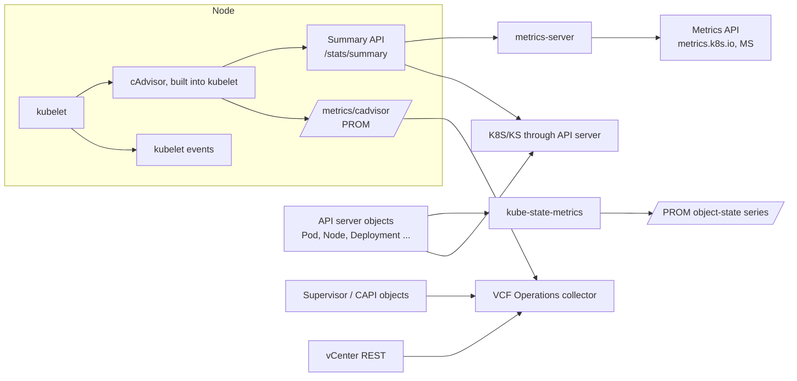

# VKS Metric Formulas

How each metric in [metrics.md](metrics.md) is calculated. The field names come from the lab (see that file). The formulas come from the Kubernetes, Linux kernel and kubernetes-mixin documentation. Where a formula is a standard derivation rather than a quote from a document, the row says so.

Related: [metrics-contention.md](metrics-contention.md), [metrics-consumption.md](metrics-consumption.md), [metrics-availability.md](metrics-availability.md), and the open doubts in [research-notes.md](research-notes.md).

## Source codes

The codes in [metrics.md](metrics.md) are kept: `VC`, `SUP`, `K8S`, `KS`, `MS`, `Derived`. Three codes are added for metrics that the lab did not collect:

| Code | Meaning | Status |
|---|---|---|
| `PROM` | Prometheus text metric from a kubelet or component `/metrics` endpoint (cAdvisor, kubelet, kube-state-metrics) | Not in the lab. Name and type from the upstream docs |
| `VCFO` | VCF Operations display name for a VKS or Supervisor metric | Not in the lab. Formula not published by Broadcom (see [research-notes.md](research-notes.md)) |
| `EVT` | Kubernetes `Event` object | Not in the lab. Fields from the Event API reference |

## How the data flows

Two rules apply to every formula below:

1. **Rates need two samples.** Cumulative counters (`usageCoreNanoSeconds`, `throttled_periods`, `rxBytes`, `restartCount` in Prometheus form) become rates by taking the difference between two samples divided by the time between them: `rate = (x(t2) − x(t1)) / (t2 − t1)`.
2. **Kubernetes omits zero status fields.** A missing field usually means zero. The *(schema)* marks in [metrics.md](metrics.md) apply here too.

## Supervisor (object type 1)

| Metric | Formula | Source | Notes |
|---|---|---|---|
| CPU Used / Capacity | Read as is | VC `info.stats.cpu_used`, `cpu_capacity` | MHz. Hypervisor units, not Kubernetes cores |
| CPU Utilization | `cpu_used ÷ cpu_capacity × 100` | Derived | % |
| Memory Utilization | `memory_used ÷ memory_capacity × 100` | Derived | % |
| Storage Utilization | `storage_used ÷ storage_capacity × 100` | Derived | % |
| Number of VKS Clusters | count of `cluster.x-k8s.io` `Cluster` objects | Derived | |
| Number of Supervisor Services in Error | count where `config_status` = `ERROR` | Derived | |

## Supervisor Namespace (object type 2)

| Metric | Formula | Source | Notes |
|---|---|---|---|
| CPU / Memory / Storage Used | Read as is (`stats.cpu_used`, `memory_used`, `storage_used`) | VC | MHz, MB, MB |
| Storage Utilization vs limit | `status.total[].scQuotaUsage.used ÷ status.appliedLimit × 100` | Derived / SUP | `StoragePolicyQuota` per storage class. Field paths from the lab; the formula is not in a Broadcom doc (see [research-notes.md](research-notes.md)) |
| Storage Used / Reserved | Read `scQuotaUsage.used` and `.reserved` | SUP | Reserved counts toward the quota before it is used |
| Number of VMs / vSphere Pods / VKS Clusters | count of objects in the namespace | Derived | |

## K8s Cluster (object type 4)

| Metric | Formula | Source | Notes |
|---|---|---|---|
| Worker Nodes Ready | `status.workers.readyReplicas` | SUP | Read as is |
| Node readiness ratio | `readyReplicas ÷ desiredReplicas × 100` | Derived | Below 100 % means nodes are missing or not ready |
| CPU Capacity / Allocatable | Σ over Nodes of `status.capacity.cpu` (or `allocatable.cpu`) | Derived | cores |
| Memory Capacity / Allocatable | Σ over Nodes of `status.capacity.memory` | Derived | bytes |
| CPU Usage | Σ over Nodes of `node.cpu.usageNanoCores` ÷ 1e9 | Derived (KS or MS) | cores |
| CPU requests utilization | Σ `spec.containers[].resources.requests.cpu` ÷ Σ `status.allocatable.cpu` × 100 | Derived | Scheduler view. A high value means no room is left for new pods, even if usage is low |
| Memory requests utilization | Σ requests.memory ÷ Σ allocatable.memory × 100 | Derived | Same as CPU |

## K8s Node Pool (object type 5)

| Metric | Formula | Source | Notes |
|---|---|---|---|
| Nodes Ready ratio | `status.readyReplicas ÷ spec.replicas × 100` | SUP | Derived from the `MachineDeployment` |
| Nodes Up-to-date ratio | `status.upToDateReplicas ÷ spec.replicas × 100` | SUP | Share of nodes on the desired version |

## K8s Node (object type 6)

| Metric | Formula | Source | Notes |
|---|---|---|---|
| CPU Usage (cores) | `node.cpu.usageNanoCores ÷ 1e9` | KS | kubelet computes the rate. The raw counter is `usageCoreNanoSeconds` |
| CPU Usage (rate, from counter) | `Δ usageCoreNanoSeconds ÷ Δ t_ns`, where `Δ t_ns` is the elapsed time in nanoseconds | Derived | Standard derivation. Use it when only the counter is available |
| CPU Utilization | `usageNanoCores ÷ (allocatable.cpu × 1e9) × 100` | Derived | % of allocatable |
| Memory Utilization | `node.memory.workingSetBytes ÷ status.allocatable.memory × 100` | Derived | Working set, not `usageBytes` (see the note on working set below) |
| Memory available (eviction signal) | `status.capacity.memory − node.memory.workingSetBytes` | KS, K8S | Kubernetes eviction signal definition (verified text) |
| Network throughput | `Δ node.network.rxBytes ÷ Δ t` (and `txBytes`) | Derived | bytes/s |
| Network error rate | `Δ node.network.rxErrors ÷ Δ t` (and `txErrors`) | Derived | errors/s |
| Filesystem Utilization | `node.fs.usedBytes ÷ node.fs.capacityBytes × 100` | Derived | % |
| Filesystem available (eviction signal) | `node.fs.availableBytes ÷ node.fs.capacityBytes × 100` | KS | Kubernetes `nodefs.available` |
| Inode free (eviction signal) | `node.fs.inodesFree ÷ node.fs.inodes × 100` | KS | Kubernetes `nodefs.inodesFree` |
| PID available (eviction signal) | `node.rlimit.maxpid − node.rlimit.curproc` | KS | Kubernetes `pid.available` |
| Major page-fault rate | `Δ node.memory.majorPageFaults ÷ Δ t` | Derived | faults/s |
| CPU / Memory PSI | `node.cpu.psi.some.avg10` etc. | KS | % (see the PSI section below) |

## K8s Namespace (object type 7)

| Metric | Formula | Source | Notes |
|---|---|---|---|
| CPU Usage | Σ over pods of `pods[].cpu.usageNanoCores ÷ 1e9` | Derived (KS or MS) | cores |
| Memory Usage | Σ over pods of `pods[].memory.workingSetBytes` | Derived (KS or MS) | bytes |
| Quota Utilization | `status.used.<resource> ÷ status.hard.<resource> × 100` | K8S | `ResourceQuota`. Not in the lab (see *(schema)*) |

## K8s Workload (object type 8)

| Metric | Formula | Source | Notes |
|---|---|---|---|
| Availability ratio | `status.availableReplicas ÷ spec.replicas × 100` | K8S | Deployment, StatefulSet, ReplicaSet |
| Ready ratio | `status.readyReplicas ÷ spec.replicas × 100` | K8S | |
| Unavailable | `status.unavailableReplicas` | K8S | Deployment *(schema)* |
| CPU / Memory Usage | Σ over its pods, as for the namespace | Derived | |

## K8s Pod (object type 9)

| Metric | Formula | Source | Notes |
|---|---|---|---|
| CPU Usage (cores) | `pods[].cpu.usageNanoCores ÷ 1e9` | KS | Pod sum of containers |
| CPU Usage (cumulative) | `pods[].cpu.usageCoreNanoSeconds` | KS | Counter. Use with the Δ t formula above |
| CPU Usage (MS) | Σ `containers[].usage.cpu` | MS | Quantity string, for example `106654804n` |
| Memory Utilization | `pods[].memory.workingSetBytes ÷ Σ limits.memory × 100` | Derived | Limit-based. Undefined when no limit is set |
| Restarts (total) | Σ `status.containerStatuses[].restartCount` | Derived | Count |
| Restart rate | `Δ restartCount ÷ Δ t` | Derived | restarts/s. Usually reported per hour |
| Network throughput | `Δ pods[].network.rxBytes ÷ Δ t` | Derived | bytes/s |
| Volume utilization | `pods[].volume[].usedBytes ÷ capacityBytes × 100` | Derived | Includes PVCs |

## K8s Container (object type 10)

| Metric | Formula | Source | Notes |
|---|---|---|---|
| CPU Usage (cores) | `containers[].cpu.usageNanoCores ÷ 1e9` | KS | |
| CPU Utilization vs limit | `usageNanoCores ÷ (limits.cpu × 1e9) × 100` | Derived | Normally at most 100 %, because CFS enforces the limit (kubelet docs: "a hard limit the kernel enforces") |
| CPU Throttle ratio | `Δ nr_throttled ÷ Δ nr_periods × 100` | PROM | cgroup `cpu.stat` (kernel). Prometheus name `container_cpu_cfs_throttled_periods_total ÷ container_cpu_cfs_periods_total` |
| Throttled time rate | `Δ throttled_time ÷ Δ t` | PROM | `container_cpu_cfs_throttled_seconds_total` |
| CFS quota for a CPU limit | `cpu.cfs_quota_us = limits.cpu (millicores) × 100` with `cpu.cfs_period_us = 100000` | Derived | 1000 m = 100 000 µs per 100 ms period. Standard derivation |
| Memory Utilization vs limit | `containers[].memory.workingSetBytes ÷ (limits.memory) × 100` | Derived | The OOM kill threshold is the limit. The kernel only acts when it detects memory pressure |
| Memory working set | `usage − inactive_file` | PROM / KS | cAdvisor definition (secondary source, see [research-notes.md](research-notes.md)) |
| Restart count | `status.containerStatuses[].restartCount` | K8S | |
| Last exit code | `lastState.terminated.exitCode` | K8S | 137 means OOM killed or SIGKILL |
| CPU / Memory PSI | `containers[].{cpu,memory}.psi.some.avg10` | KS | VKS only |

## Pressure Stall Information (PSI)

Kubernetes PSI metrics use the Linux PSI definitions (the kernel's `/proc/pressure`):

- `some`: at least one task is stalled on the resource. The share of wall-clock time is shown as a percentage.
- `full`: all non-idle tasks are stalled at the same time.
- `avg10`, `avg60`, `avg300`: moving averages over 10 s, 60 s and 5 min windows, as a percentage of time.
- `total`: cumulative stall time in microseconds (a counter).

Kubernetes docs (`understand-psi-metrics`) confirm these definitions. The Kubernetes page does not give the averaging formula behind `avg10`; the kernel computes it as a moving average, which is not verified here.

## Units

| Quantity | Kubernetes raw | Converted |
|---|---|---|
| CPU | nanocores (1e-9 core) | cores = nanocores ÷ 1e9; millicores = nanocores ÷ 1e6 |
| Memory | bytes; MS quantity `Ki`, `Mi`, `Gi` (binary) | bytes = value × 1024^n |
| Time | nanoseconds (`usageCoreNanoSeconds`) | seconds = ns ÷ 1e9 |
| Supervisor CPU | MHz | Not comparable to cores without the host clock speed |
